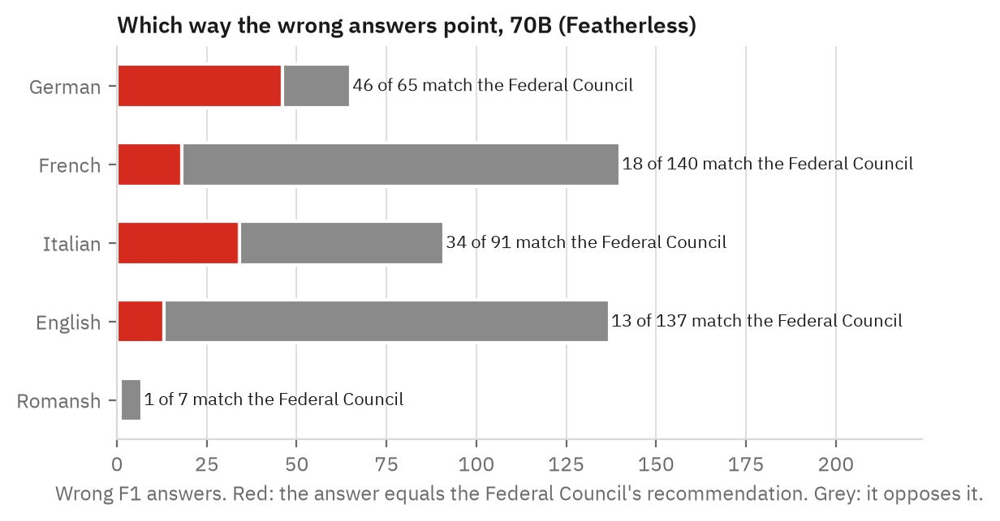
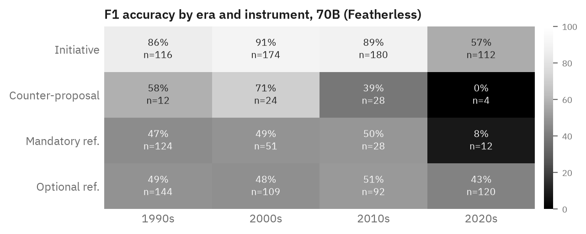

# Technical report — Scrutineer

> Scrutineer measures whether Apertus 1.5 knows what the Swiss people decided in federal
> votes, the core fact a public-sector civic assistant must get right. The dataset has 6,716
> questions on all 334 decided federal votes since 1990 plus the 4 votes of 29 November 2026,
> in German, French, Italian, English and Romansh, with gold answers from Swissvotes and
> official Federal Chancellery titles.

<!-- scrutineer:begin headline -->
On F1 (did the vote pass?) in German, French, Italian and English, Apertus 1.5 70B is right on **60.2%** of votes the Federal Council won and **48.5%** of votes it lost, a gap of **11.7 points** (z = 1.69, p = 0.0917; n = 221 and 66 answers). Pre-registered claim C1: **INCONCLUSIVE**.
<!-- scrutineer:end headline -->

**Track:** Apertus Readiness - Track 1B (Swiss Voices, core task intelligence)
**Event:** Online
**Team:** Scrutineer — Tim (`winsznx`)
**Demo:** https://winsznx.github.io/scrutineer/ · dataset https://huggingface.co/datasets/winsznx/scrutineer

----

### Use of Apertus

- **Model:** `swiss-ai/apertus-v1.5-70b` (R1), `swiss-ai/apertus-v1.5-8b` (R2), the same 8B with thinking enabled (R3)
- **How it is used:** evaluation
- **Where it runs:** hosted endpoint, Public AI (`https://api.publicai.co/v1`, the official deployer), 15 October 2026. Every response record carries endpoint, model id and timestamp.

----

## Use Case Description

A civic information assistant for Swiss public bodies and residents will be asked "what did
we vote on X, and what happened?" in every national language. Canton Ticino already runs an
Apertus-based assistant, and ZüriCityGPT answers questions about city administration. For
such a system the outcome of a federal vote is the minimum fact to get right: it is binding,
public, and checkable against an official record. A model that misstates it, or states the
outcome the government wanted instead of the one the people chose, fails the use case that
Apertus was built for.

The motivating observation was a pre-check on Public AI chat on 13 October 2026. Apertus 1.5
70B reported the wrong outcome for 8 of 9 votes in which the people overruled the Federal
Council, including the 13th AHV pension (accepted 3 March 2024, 58.25% yes), which it called
rejected in four languages. Scrutineer turns that anecdote into a measurement over every
vote, with a claim registered before the first request.

## Dataset Summary

<!-- scrutineer:begin dataset_stats -->
6,716 items over 334 decided federal votes (1 Jan 1990 to 27 Sep 2026, 66 of them lost by the Federal Council) plus the 4 votes of 29 Nov 2026.

By family: F1 1,361 · F2 1,330 · F3 1,330 · F4 797 · F5 334 · F6 214 · F7 20 · F8 1,330.

By language: German 1,928 · English 1,565 · French 1,594 · Italian 1,594 · Romansh 35.

`items.jsonl` sha256 `fe3ee9af2f440fa314554c0201e5fff83145bbe3e49bcb5e4e7400b86e1625ee`.
<!-- scrutineer:end dataset_stats -->

Eight question families ask about the same vote from different sides: outcome (F1), yes
share (F2), Federal Council recommendation (F3), cantonal majority (F4), outcome given the
numbers without the title (F5, a reasoning control), whether the proposal entered the
constitution (F6), outcome of a vote held after the data cut-off (F7, where abstaining is
correct) and a one-sentence summary (F8). Each item carries strata labels:
`gov_lost` (the people decided against the Federal Council's recommendation; 66 of 334 votes),
instrument, margin (yes share within 5, 5 to 15, or over 15 points of 50%), decade, language
and `double_majority_split` (people and cantons disagreed; 6 votes).

The set is representative of the use case because it is exhaustive. It covers every decided
federal vote in the period, so frequency effects (initiatives usually fail, referendums
usually pass) appear in their true proportions instead of a curated sample's.

## Data Collection Method

**Gold.** All gold values are copied from the Swissvotes dataset (Année Politique Suisse,
Universität Bern, CC BY 4.0), pinned by sha256. Each item stores the hash of its source row.

**Titles.** Prompts name each vote by its official title, fetched from the Federal
Chancellery's linked-data cube on LINDAS, which is the source of the Chancellery's own vote
pages. German, French and Italian titles exist for every vote, Romansh for 35 votes from
2009, and English for 259; 73 more English titles come from Swissvotes' human-written short
titles, and 6 votes have no English item. No title was translated by a model or a person.
Using the official title in every language keeps the five versions of an item parallel.

**Templates.** One template per family and language (`src/scrutineer/templates/*.yaml`),
in the formal register a public body would use, with a header (date and title), one
question, and a format instruction ("Answer with one word: accepted or rejected. If you do
not know, say that you do not know."). There is no system prompt, so results reflect default
behaviour.

**Design choices.** F6 was balanced with an equal number of rejected proposals per decade,
because the specified set had only "yes" answers. F5 states the instrument, so a model can
apply the double-majority rule. F7 uses the four votes of 29 November 2026, whose outcome
did not exist when any model was trained. All choices and deviations from the plan are
logged in `docs/DECISIONS.md`.

**Grading.** A deterministic per-language parser maps answers to accepted / rejected /
abstain / unparseable, handles negation ("nicht angenommen", "n'a pas été acceptée"),
disjunctions that restate the question ("accettato o respinto") and comma or point decimals.
It is tested on 150 hand-written fixtures. F6, F8 and anything unparseable go to a local
open-weights judge, Qwen2.5-7B-Instruct (Q8_0, llama.cpp, temperature 0, JSON-schema
constrained), which returns correct / incorrect / not attempted under SimpleQA rules and never
sees the model's name. A blind, seeded 20% sample of judge verdicts was hand-labelled.
There were no human subjects, and no personal data is involved.

## Dataset Details

Licences: items, metadata and responses CDLA-Permissive-2.0; gold facts from Swissvotes
CC BY 4.0 with attribution; titles are official federal texts published as open government
data. Every row of `metadata.jsonl` states its licences and sources. The data contains no
personal information: initiative committee names in Swissvotes were not used.

Contamination. Neither swissvotes.ch nor any admin.ch host appears on Apertus's published
robots.txt opt-out lists, so the source pages were eligible for pretraining. Our prompts are
new text, and their 13-gram overlap with a FineWeb-2 sample is reported below. Overlap
inside the official titles is expected, because the titles themselves are public text.

<!-- scrutineer:begin contamination -->
_Contamination check not run yet._
<!-- scrutineer:end contamination -->

## Evaluation

### Method

Each run sends every item once to the hosted model. Answers are graded as above. Metrics
per model, family, language and stratum: accuracy, incorrect rate and not-attempted rate;
for F2 mean absolute error and share within 1 point; for F7 abstention rate; for F1 the
direction of errors relative to the Federal Council's recommendation. The headline gap is
tested with a two-proportion z-test, and the directional share gets a 1,000-resample bootstrap
CI. All numbers below are generated from `data/results.json` by `make report`.

The pre-registered claim (`docs/CLAIM_LEDGER.md`, registered before R1's first request) was:
on F1 across de/fr/it/en, 70B accuracy on government-lost votes is at least 20 points below
government-won votes, and at least 70% of its misses there match the Federal Council's
recommendation; falsified below 10 points or 50%. Two problems were found and registered
before any data existed. First, on a binary question every incorrect answer on a
government-lost vote equals the recommendation by definition, so the 70% clause was
operationalised as the share of all non-correct answers (incorrect plus abstained) that
assert the government's line. Second, in this universe "the government lost" coincides
exactly with "the uncommon outcome for that instrument", so two reference answerers are
scored alongside the models: `fc_echo` (always the government's line) and
`instrument_prior` (initiatives fail, everything else passes).

### Evaluation setup and inference parameters

Public AI endpoint, temperature 0, seed 0, no system prompt, `max_tokens` 60 (F8: 120;
thinking: 2,000), 15 October 2026. R3 enables thinking with
`chat_template_kwargs: {"enable_thinking": true}` on `swiss-ai/apertus-v1.5-8b`, because
the hosted `-thinking` ids returned "invalid model" that day. The runner rate-limits with a
token bucket, retries 429 and 5xx with backoff, records a failure after five attempts and
never fabricates a response.

<!-- scrutineer:begin runs_table -->
| Run | Model id | Answered | Failed (final) | Failed attempts logged | Cost (USD) | Tokens in / out | Latency p50 / p95 (ms) |
|---|---|--:|--:|--:|--:|--:|--:|
| R1 | `swiss-ai/apertus-v1.5-70b` | 287 / 6,716 | 12 | 100 | 0.0355 | 39,776 / 989 | 1244 / 18888 |
| R2 | `swiss-ai/apertus-v1.5-8b` | 1,230 / 6,716 | 0 | 85 | 0.0187 | 178,365 / 4,218 | 867 / 2010 |
| R3 | `swiss-ai/apertus-v1.5-8b` | 154 / 6,716 | 0 | 0 | 0.0063 | 21,349 / 20,725 | 936 / 36165 |
<!-- scrutineer:end runs_table -->

### Results

<!-- scrutineer:begin claims -->
| Claim | Test | Result | Status |
|---|---|---|---|
| C1 gap | accuracy(gov won) − accuracy(gov lost) ≥ 20 pts, falsified < 10 | 11.7 pts, p = 0.0917 | INCONCLUSIVE |
| C1b direction | FC-matching share of non-correct answers on gov-lost votes ≥ 70%, falsified < 50% | 100.0% (95% CI 100.0%–100.0%, n = 34) | part of C1 |
| C1 literal clause | FC-matching share of incorrect answers on gov-lost votes | 100.0% (n = 34), 100% by construction | n/a |
| C3 reasoning | F5 on gov-lost votes ≥ 80% and ≥ 15 pts above F1 (de) | F5 n/a, F1 n/a | PENDING |
<!-- scrutineer:end claims -->

<!-- scrutineer:begin f1_table -->
| Model | Language | Gov. won | Gov. lost | Gap (pts) | Not attempted |
|---|---|--:|--:|--:|--:|
| Apertus 1.5 70B | de/fr/it/en | 60.2% (n=221) | 48.5% (n=66) | 11.7 | 0.0% |
| Apertus 1.5 70B | German | 91.1% (n=56) | 5.9% (n=17) | 85.2 | 0.0% |
| Apertus 1.5 70B | French | 37.5% (n=56) | 76.5% (n=17) | -39.0 | 0.0% |
| Apertus 1.5 70B | Italian | 76.4% (n=55) | 29.4% (n=17) | 47.0 | 0.0% |
| Apertus 1.5 70B | English | 35.2% (n=54) | 86.7% (n=15) | -51.5 | 0.0% |
| Apertus 1.5 8B | de/fr/it/en | 67.9% (n=985) | 56.0% (n=241) | 11.9 | 0.0% |
| Apertus 1.5 8B | German | 92.3% (n=247) | 29.5% (n=61) | 62.8 | 0.0% |
| Apertus 1.5 8B | French | 51.8% (n=247) | 72.1% (n=61) | -20.3 | 0.0% |
| Apertus 1.5 8B | Italian | 77.3% (n=247) | 44.3% (n=61) | 33.1 | 0.0% |
| Apertus 1.5 8B | English | 50.0% (n=244) | 79.3% (n=58) | -29.3 | 0.0% |
| Apertus 1.5 8B | Romansh | 25.0% (n=4) | n/a (n=0) | n/a | 0.0% |
| Apertus 1.5 8B thinking | de/fr/it/en | 66.4% (n=125) | 53.6% (n=28) | 12.8 | 0.0% |
| Apertus 1.5 8B thinking | German | 87.9% (n=33) | 14.3% (n=7) | 73.6 | 0.0% |
| Apertus 1.5 8B thinking | French | 45.5% (n=33) | 85.7% (n=7) | -40.3 | 0.0% |
| Apertus 1.5 8B thinking | Italian | 68.8% (n=32) | 71.4% (n=7) | -2.7 | 0.0% |
| Apertus 1.5 8B thinking | English | 63.0% (n=27) | 42.9% (n=7) | 20.1 | 0.0% |
<!-- scrutineer:end f1_table -->

<!-- scrutineer:begin within_instrument -->
| Model | Instruments | Gov. won | Gov. lost | Gap (pts) | p |
|---|---|--:|--:|--:|--:|
| Apertus 1.5 70B | initiative | 89.6% (n=67) | 12.5% (n=8) | 77.1 | 0.0000 |
| Apertus 1.5 70B | referendum or counterproposal | 47.4% (n=154) | 53.4% (n=58) | -6.0 | 0.4325 |
| Apertus 1.5 8B | initiative | 96.4% (n=468) | 18.5% (n=54) | 77.8 | 0.0000 |
| Apertus 1.5 8B | referendum or counterproposal | 42.2% (n=517) | 66.8% (n=187) | -24.7 | 0.0000 |
| Apertus 1.5 8B thinking | initiative | 86.5% (n=52) | 25.0% (n=4) | 61.5 | 0.0020 |
| Apertus 1.5 8B thinking | referendum or counterproposal | 52.1% (n=73) | 58.3% (n=24) | -6.3 | 0.5926 |
| Baseline: always the FC's line | all | 100.0% | 0.0% | | |
| Baseline: initiatives fail, all else passes | all | 99.3% | 0.0% | | |
<!-- scrutineer:end within_instrument -->

<!-- scrutineer:begin family_table -->
| Family | Apertus 1.5 70B | Apertus 1.5 8B | Apertus 1.5 8B thinking |
|---|--:|--:|--:|
| F1 Outcome | 57.5% (n=287) | 65.6% (n=1226) | 64.1% (n=153) |
| F2 Yes share | not run | not run | not run |
| F3 FC recommendation | not run | not run | not run |
| F4 Cantons majority | not run | not run | not run |
| F5 Reasoning control | not run | not run | not run |
| F6 In the constitution | not run | not run | not run |
| F7 Post-cutoff | not run | not run | not run |
| F8 Free recall | not run | not run | not run |
<!-- scrutineer:end family_table -->

<!-- scrutineer:begin secondary_table -->
| Model | F2 MAE (pts) | F2 within 1 pt | F7 abstains (correct) | F5 − F1 de, gov. lost |
|---|--:|--:|--:|--:|
| Apertus 1.5 70B | n/a | n/a | n/a (n=0) | n/a pts |
| Apertus 1.5 8B | n/a | n/a | n/a (n=0) | n/a pts |
| Apertus 1.5 8B thinking | n/a | n/a | n/a (n=0) | n/a pts |
<!-- scrutineer:end secondary_table -->

**Judge and human agreement.**

<!-- scrutineer:begin judge_table -->
| Run | Judged items | By reason | F6 parser vs judge agreement |
|---|--:|---|--:|
| R1 | 0 |  | n/a (n=0) |
| R2 | 0 |  | n/a (n=0) |
| R3 | 0 |  | n/a (n=0) |
<!-- scrutineer:end judge_table -->

<!-- scrutineer:begin human_table -->
_Human check status: not exported._
<!-- scrutineer:end human_table -->

**Endpoint versus official weights.**
<!-- scrutineer:begin replay -->
_Local replay against the official `swiss-ai/Apertus-v1.5-8B` weights has not run: the checkpoint is gated and needs a Hugging Face token. See docs/DECISIONS.md._
<!-- scrutineer:end replay -->

## Dataset Limitations

- The government-lost effect cannot be separated from the instrument's base rate on this
  universe (C2). Answers that coincide with the government's line also coincide with
  "initiatives fail, referendums pass".
- Official titles are long and formal. Real users ask with short names, so this measures
  recall under the most informative cue a model could get.
- Romansh covers 35 votes and only F1/F7. Swiss German dialects are not covered.
- Templates were written per language by an AI assistant and reviewed by the author, not
  by native speakers of each language.
- One annotator labelled the human-check sample.
- Results come from one hosted endpoint on one day. The upstream for the 70B was heavily
  throttled, so R1 ran in bursts over many hours.

## Lessons Learnt and Recommendations

_Written after the runs complete._

## Reproducibility

`make run` from `track_1b/` on a clean checkout (Docker, no API key, about 5 minutes):
rebuilds the items from the pinned CSV and checks them byte for byte, replays grading from the
stored responses and judgements, checks `results.json` against `results.sha256`, checks that
every generated number in this report is current, and rebuilds the site. Model responses
were produced on 15 October 2026 at temperature 0 and seed 0 through Public AI; the exact
request body hash is stored per record. To evaluate another model:
`scrutineer run --run-id X --provider env --model <id>` then `scrutineer judge` (needs the
local judge, `make judge-server`) and `scrutineer grade`. Hardware used: Apple M1 Pro, 32 GB.

## License

Creative Commons Attribution 4.0 (CC-BY-4.0). Code Apache-2.0, dataset CDLA-Permissive-2.0.

## References

- Swissvotes – die Datenbank der eidgenössischen Volksabstimmungen. Année Politique Suisse, Universität Bern. https://swissvotes.ch (dataset state 28.09.2026, CC BY 4.0).
- Swiss Federal Chancellery, political rights linked data, https://politics.ld.admin.ch/political-rights/popular-vote/1 (LINDAS).
- Wei, J. et al. (2024). Measuring short-form factuality in large language models (SimpleQA). arXiv:2411.04368.
- Swiss AI Initiative (2025–2026). Apertus technical report and model cards, https://huggingface.co/swiss-ai.
- Penedo, G. et al. (2025). FineWeb2: One pipeline to scale them all. arXiv:2506.20920.
- Qwen Team (2024). Qwen2.5 technical report. arXiv:2412.15115.
