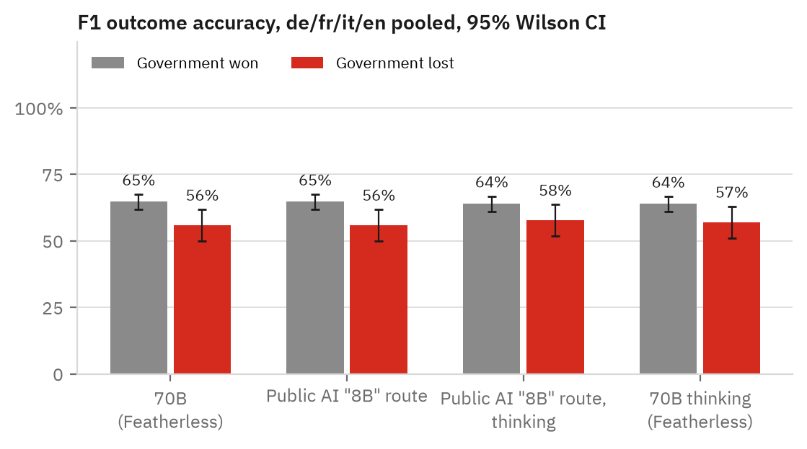
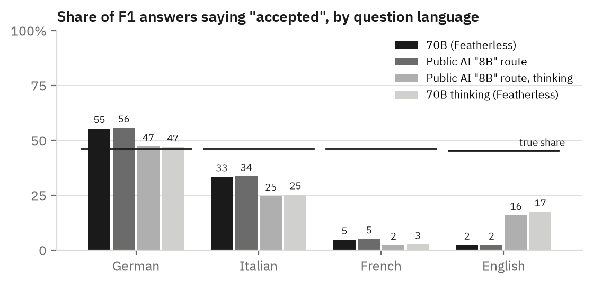
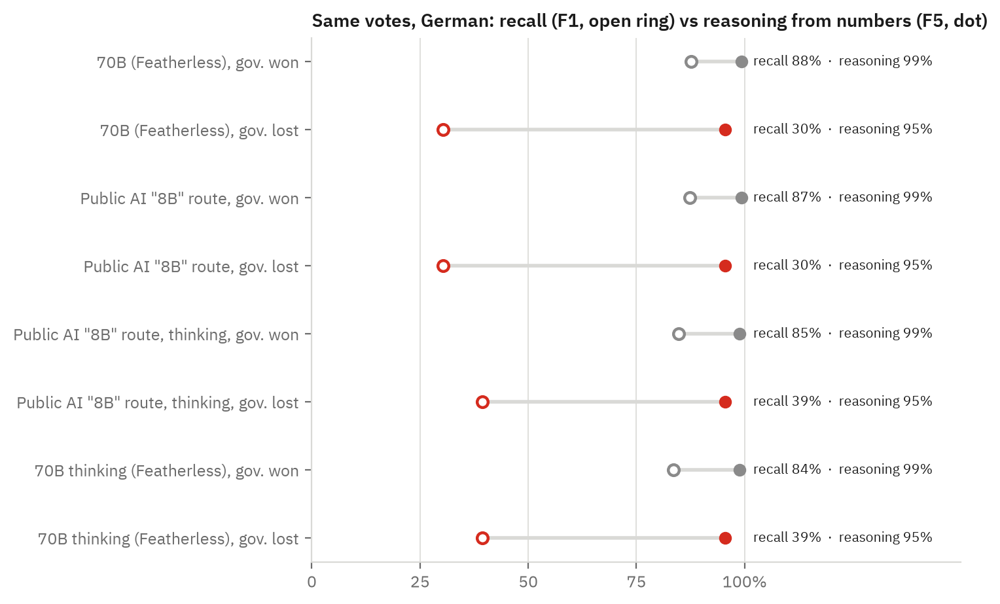

# Scrutineer: does Apertus know what the Swiss people decided?

> Scrutineer asks Apertus 1.5 about every Swiss federal vote since 1990, in German, French,
> Italian, English and Romansh: 6,716 questions with gold answers from Swissvotes and official
> Federal Chancellery titles. Our pre-registered claim, that Apertus misremembers votes the
> government lost and repeats the government's line, failed. What the data shows instead is a
> default answer: Apertus says "rejected" far more often than votes were rejected, and how
> often depends on the language of the question.

<!-- scrutineer:begin headline -->
On F1 (did the vote pass?) in German, French, Italian and English, Apertus 1.5 70B is right on **64.7%** of votes the Federal Council won and **55.9%** of votes it lost, a gap of **8.8 points** (z = 2.64, p = 0.0083; n = 1069 and 261 answers). Pre-registered claim C1: **FAILED**.
<!-- scrutineer:end headline -->

**Track:** Apertus Readiness, Track 1B (Swiss Voices, core task intelligence) ·
**Event:** Online · **Team:** Scrutineer, Tim (`winsznx`) ·
**Demo:** https://winsznx.github.io/scrutineer/ · **Dataset:** https://huggingface.co/datasets/winsznx/scrutineer

### Use of Apertus

- **Model:** `swiss-ai/Apertus-v1.5-70B` (R1, R4 with thinking). Public AI's `swiss-ai/apertus-v1.5-8b` id (R2, R3 with thinking) was also run, but its answers match the 70B word for word (Section 5.4), so no 8B result is claimed.
- **How it is used:** evaluation.
- **Where it runs:** hosted endpoints on 15 and 16 October 2026: Featherless through the Hugging Face router (R1, R4) and Public AI (R2, R3). Every response record stores provider, endpoint, model id, request hash and timestamp.

## 1. Use case

A civic assistant for Swiss public bodies will be asked "what did we vote on, and what happened?"
in every national language. The outcome of a federal vote is the least such a system must get
right: it is binding, public and checkable. A pre-check on 13 October 2026 found Apertus 1.5
70B calling the 13th AHV pension (accepted 3 March 2024 with 58.25% yes) rejected in four
languages. Scrutineer turns that anecdote into a measurement over every vote, with the claim
written down before the first request (`docs/CLAIM_LEDGER.md`).

## 2. Dataset

<!-- scrutineer:begin dataset_stats -->
6,716 items over 334 decided federal votes (1 Jan 1990 to 27 Sep 2026, 66 of them lost by the Federal Council) plus the 4 votes of 29 Nov 2026.

By family: F1 1,361 · F2 1,330 · F3 1,330 · F4 797 · F5 334 · F6 214 · F7 20 · F8 1,330.

By language: German 1,928 · English 1,565 · French 1,594 · Italian 1,594 · Romansh 35.

`items.jsonl` sha256 `fe3ee9af2f440fa3…` (full hash in `data/items.manifest.json`).
<!-- scrutineer:end dataset_stats -->

The universe is every federal vote from 1 January 1990 to 27 September 2026 with a decided
outcome and a Federal Council recommendation of accept or reject (334 votes, 66 of them lost
by the government), plus the four votes of 29 November 2026, which had not taken place. Eight
question families ask about the same vote from different sides:

| | Asks | Gold | Graded by |
|---|---|---|---|
| F1 | accepted or rejected? | `annahme` | parser |
| F2 | yes share? (±1 point) | `volkja-proz` | parser |
| F3 | Federal Council recommendation? | `br-pos` | parser |
| F4 | majority of cantons? | `kt-ja` > `kt-nein` | parser |
| F5 | accepted, given yes share and cantonal votes (no title) | `annahme` | parser |
| F6 | written into the constitution? (balanced yes/no) | `annahme` | judge |
| F7 | outcome of a 29 Nov 2026 vote | not decided | parser |
| F8 | one-sentence summary | outcome, recommendation, yes share | judge |

Every item stores the sha256 of the Swissvotes CSV row its gold comes from, the source URLs,
the template and generator versions, and six strata: `gov_lost`, instrument, margin, decade,
language, and whether people and cantons disagreed. No other public benchmark tests recall of
Swiss vote outcomes, in any language.

## 3. Data collection

**Gold** is copied from the Swissvotes dataset (Année Politique Suisse, Universität Bern,
CC BY 4.0), pinned by sha256 (`data/SOURCES.md`). **Titles** are the Federal Chancellery's
official titles from its linked-data cube on LINDAS, the source of the Chancellery's own vote
pages, in all five languages. The five versions of an item therefore name the vote the same
way. No title was translated by anyone; English falls back to Swissvotes' human-written short
title for 73 votes, and 6 votes have no English item. **Templates** are one per family and
language, in the formal register, with a format instruction and no system prompt. **F6** was
balanced with rejected proposals (the specified set was all "yes"). The build is deterministic:
`make run` rebuilds `items.jsonl` byte for byte. All departures from the plan are in
`docs/DECISIONS.md` (D1 to D24).

**Grading.** A per-language parser (150 fixtures) reads accepted / rejected / abstain /
unparseable, with negation and "accepted or rejected" disjunctions handled. F6, F8 and
anything unparseable go to a local open-weights judge, Qwen2.5-7B-Instruct (Q8_0, llama.cpp,
temperature 0, JSON-schema output), which never sees the model name. There are no human
subjects and no personal data.

**Human check.** A seeded 20% of R2's judged items (311) was exported blind (no judge
verdict, run or language). A second rater, Claude, labelled all 311 blind. The human labeller
reviewed the sheet with Claude's labels visible and overrode two. The human check therefore
confirms Claude's labels rather than adding an independent annotation, and we say so
wherever the number appears. It found a judge bug: version 1.0.0 read "rejected by a majority
of voters" as contradicting a low yes share. Judge 1.1.0 spells out the derived facts (no
share, winning side) and every run was re-judged (D22). The bug was found on these rows, so
1.1.0's agreement on them is optimistic.

<!-- scrutineer:begin human_table -->
Labelled 311 of 311 sampled judgements (complete). The labeller saw a blind Claude pre-label; human and Claude agree on 99.4% of rows, so judge versus human is close to judge versus Claude and is not an independent second annotation.

| Language | n | Judge 1.1.0 vs human | κ | Judge 1.0.0 vs human | κ |
|---|--:|--:|--:|--:|--:|
<!-- scrutineer:end human_table -->

**Contamination.** None of swissvotes.ch, bk.admin.ch or admin.ch is on Apertus's robots.txt
opt-out lists, so the source pages were eligible for pretraining. Our prompt wording is new
text: in a FineWeb-2 sample its 13-grams appear only inside official titles.

<!-- scrutineer:begin contamination -->
Apertus robots.txt opt-out lists: `fw1_domains.txt` (487,666 hosts): no swissvotes.ch or admin.ch host; `fw2_domains.txt` (333,971 hosts): no swissvotes.ch or admin.ch host.

| Language | Prompts | With a 13-gram hit | Inside the title only | Touching template | Titles found verbatim |
|---|--:|--:|--:|--:|--:|
| German | 1,928 | 6 | 6 | 0 | 1 of 337 |
| French | 1,594 | 9 | 8 | 1 | 0 of 337 |
| Italian | 1,594 | 9 | 9 | 0 | 0 of 338 |

Sample: 100,000 FineWeb-2 documents per language (revision `af9c1333`, seed 0). Details in `docs/CONTAMINATION.md`.
<!-- scrutineer:end contamination -->

## 4. Evaluation setup

Temperature 0, seed 0, no system prompt, `max_tokens` 60 (F8: 120; thinking: 2,000).
Thinking is switched on with `chat_template_kwargs: {"enable_thinking": true}` (D17).
R4 is a pre-registered stratified sample in matched lost/won pairs (CLAIM_LEDGER, R4).

<!-- scrutineer:begin runs_table -->
| Run | Model id | Answered | Failed (final) | Failed attempts logged | Cost (USD) | Tokens in / out | Latency p50 / p95 (ms) |
|---|---|--:|--:|--:|--:|--:|--:|
| R1 | `swiss-ai/Apertus-v1.5-70B` | 6,716 / 6,716 | 0 | 0 | 1.0291 | 973,764 / 85,120 | 1626 / 3373 |
| R2 | `swiss-ai/apertus-v1.5-8b` | 6,716 / 6,716 | 0 | 85 | 0.1144 | 973,764 / 85,312 | 880 / 3812 |
| R3 | `swiss-ai/apertus-v1.5-8b` | 6,656 / 6,716 | 0 | 2 | 0.4209 | 966,175 / 1,621,344 | 1332 / 37506 |
| R4 | `swiss-ai/Apertus-v1.5-70B` | 50 / 6,716 | 0 | 0 | 0.0268 | 6,828 / 10,028 | 1282 / 50552 |
<!-- scrutineer:end runs_table -->

## 5. Results

### 5.1 The pre-registered claim failed

<!-- scrutineer:begin claims -->
| Claim | Test | Result | Status |
|---|---|---|---|
| C1 gap | accuracy(gov won) − accuracy(gov lost) ≥ 20 pts, falsified < 10 | 8.8 pts, p = 0.0083 | FAILED |
| C1b direction | FC-matching share of non-correct answers on gov-lost votes ≥ 70%, falsified < 50% | 96.5% (95% CI 93.0%–99.1%, n = 115) | part of C1 |
| C1 literal clause | FC-matching share of incorrect answers on gov-lost votes | 100.0% (n = 111), 100% by construction | n/a |
| C3 reasoning | F5 on gov-lost votes ≥ 80% and ≥ 15 pts above F1 (de) | F5 95.5%, F1 30.3% | SUPPORTED |
<!-- scrutineer:end claims -->

The pooled gap is small, but it hides two large effects in opposite directions:

<!-- scrutineer:begin within_instrument -->
| Model | Instruments | Gov. won | Gov. lost | Gap (pts) | p |
|---|---|--:|--:|--:|--:|
| 70B (Featherless) | initiative | 90.5% (n=524) | 17.2% (n=58) | 73.2 | 0.0000 |
| 70B (Featherless) | referendum or counterproposal | 40.0% (n=545) | 67.0% (n=203) | -27.0 | 0.0000 |
| Public AI "8B" route | initiative | 90.3% (n=524) | 17.2% (n=58) | 73.0 | 0.0000 |
| Public AI "8B" route | referendum or counterproposal | 40.2% (n=545) | 67.0% (n=203) | -26.8 | 0.0000 |
| Public AI "8B" route, thinking | initiative | 91.8% (n=515) | 17.2% (n=58) | 74.6 | 0.0000 |
| Public AI "8B" route, thinking | referendum or counterproposal | 39.1% (n=534) | 70.4% (n=199) | -31.2 | 0.0000 |
| 70B thinking (Featherless) | initiative | 100.0% (n=22) | 25.0% (n=4) | 75.0 | 0.0000 |
| 70B thinking (Featherless) | referendum or counterproposal | 75.0% (n=12) | 40.0% (n=10) | 35.0 | 0.0964 |
| Baseline: always the FC's line | all | 100.0% | 0.0% | | |
| Baseline: initiatives fail, all else passes | all | 99.3% | 0.0% | | |
<!-- scrutineer:end within_instrument -->

On initiatives the government lost (the people accepted them), the 70B is mostly wrong. On
referendums the government lost (the people rejected them), it is *more* often right than on
referendums the government won. A model that repeats the government would fail both. A model
that defaults to "rejected" fails the first and passes the second, and that is what the data
shows. The literal "70% of wrong answers match the Federal Council" clause is true, but on a
yes/no question it is true by construction (C1b, D7).

### 5.2 The answer depends on the language of the question

<!-- scrutineer:begin language_table -->
| Model | Language | Says accepted | Gold accepted | Accuracy | Abstained |
|---|---|--:|--:|--:|--:|
| 70B (Featherless) | German | 55.3% | 46.1% | 76.3% (n=334) | 4.2% |
| 70B (Featherless) | English | 2.2% | 45.4% | 54.3% (n=328) | 4.0% |
| 70B (Featherless) | French | 4.7% | 46.1% | 54.2% (n=334) | 3.9% |
| 70B (Featherless) | Italian | 33.3% | 46.1% | 67.1% (n=334) | 5.7% |
| 70B (Featherless) | Romansh | 5.6% | 41.9% | 35.5% (n=31) | 41.9% |
| Public AI "8B" route | German | 55.6% | 46.1% | 76.0% (n=334) | 4.2% |
| Public AI "8B" route | English | 2.2% | 45.4% | 54.3% (n=328) | 4.0% |
| Public AI "8B" route | French | 5.0% | 46.1% | 54.5% (n=334) | 3.9% |
| Public AI "8B" route | Italian | 33.5% | 46.1% | 67.1% (n=334) | 5.4% |
| Public AI "8B" route | Romansh | 5.6% | 41.9% | 35.5% (n=31) | 41.9% |
| Public AI "8B" route, thinking | German | 47.2% | 46.1% | 75.7% (n=334) | 4.2% |
| Public AI "8B" route, thinking | English | 15.8% | 45.1% | 59.9% (n=319) | 5.0% |
| Public AI "8B" route, thinking | French | 2.2% | 46.2% | 54.1% (n=329) | 3.0% |
| Public AI "8B" route, thinking | Italian | 24.5% | 46.3% | 64.8% (n=324) | 1.9% |
| Public AI "8B" route, thinking | Romansh | 5.6% | 41.9% | 35.5% (n=31) | 41.9% |
| 70B thinking (Featherless) | German | 46.2% | 30.8% | 69.2% (n=13) | 0.0% |
| 70B thinking (Featherless) | English | 33.3% | 44.4% | 66.7% (n=9) | 0.0% |
| 70B thinking (Featherless) | French | 7.7% | 30.8% | 76.9% (n=13) | 0.0% |
| 70B thinking (Featherless) | Italian | 46.2% | 30.8% | 84.6% (n=13) | 0.0% |

Votes where German, French, Italian and English give the same answer: 70B (Featherless): 135 of 309 (43.7%); Public AI "8B" route: 137 of 310 (44.2%); Public AI "8B" route, thinking: 153 of 303 (50.5%); 70B thinking (Featherless): 5 of 9 (55.6%).
<!-- scrutineer:end language_table -->

Asked in French or English, Apertus calls almost every proposal rejected. In German it is
close to the true rate. A resident asking in French and one asking in German get different
accounts of the same binding decision. The pre-registered order test (E2) reversed the two
options in the question:

<!-- scrutineer:begin order_swap_table -->
Same F1 items, options reversed ("rejected or accepted"), `swiss-ai/apertus-v1.5-8b`, compared with R2:

| Language | n | Says accepted, original order | Says accepted, reversed | Shift (pts) | Answer changed |
|---|--:|--:|--:|--:|--:|
| German | 334 | 55.6% | 32.5% | -23.1 | 23.4% |
| English | 328 | 2.2% | 0.0% | -2.2 | 2.4% |
| French | 334 | 5.0% | 3.4% | -1.5 | 2.4% |
<!-- scrutineer:end order_swap_table -->

French and English do not move, so their bias is not an artefact of option order. German
answers do partly follow the order of the options.

### 5.3 Reasoning works, recall does not

Given the yes share and cantonal votes without the title (F5), the model applies the
double-majority rule almost perfectly, including on votes the government lost. Asked to
recall the outcome (F1), it fails on most of those same votes. Pre-registered claim C3 holds:
the failures are recall failures. It also does not know the numbers (F2), and it abstains
correctly on votes that have not happened (F7):

<!-- scrutineer:begin family_table -->
| Family | 70B (Featherless) | Public AI "8B" route | Public AI "8B" route, thinking | 70B thinking (Featherless) |
|---|--:|--:|--:|--:|
| F1 Outcome | 63.0% (n=1330) | 63.0% (n=1330) | 63.7% (n=1306) | 75.0% (n=48) |
| F2 Yes share | 11.6% (n=1330) | 11.1% (n=1326) | 14.8% (n=1089) | not run |
| F3 FC recommendation | 79.3% (n=1330) | 79.5% (n=1322) | 85.4% (n=1301) | not run |
| F4 Cantons majority | 73.0% (n=797) | 72.8% (n=797) | 71.8% (n=785) | not run |
| F5 Reasoning control | 98.5% (n=334) | 98.5% (n=334) | 98.2% (n=334) | not run |
| F6 In the constitution | 56.1% (n=214) | not run | not run | not run |
| F7 Post-cutoff | 100.0% (n=16) | 100.0% (n=16) | 100.0% (n=16) | not run |
| F8 Free recall | 63.6% (n=132) | not run | not run | not run |
<!-- scrutineer:end family_table -->

<!-- scrutineer:begin secondary_table -->
| Model | F2 MAE (pts) | F2 within 1 pt | F7 abstains (correct) | F5 − F1 de, gov. lost |
|---|--:|--:|--:|--:|
| 70B (Featherless) | 14.5 | 13.0% | 100.0% (n=16) | 65.2 pts |
| Public AI "8B" route | 14.7 | 12.5% | 100.0% (n=16) | 65.2 pts |
| Public AI "8B" route, thinking | 12.3 | 15.4% | 100.0% (n=16) | 56.1 pts |
| 70B thinking (Featherless) | n/a | n/a | n/a (n=0) | n/a pts |
<!-- scrutineer:end secondary_table -->

### 5.4 Serving: one model, three routes, 1 answer in 12 flips

<!-- scrutineer:begin route_identity_text -->
- the official 70B (Featherless) and Public AI's "8B" route: identical text on 91.9% of 6,716 items
- the official 70B on Featherless and on Public AI: identical text on 92.3% of 287 items
- Public AI's 70B and "8B" routes: identical text on 92.3% of 287 items
- Public AI's "8B" route with thinking and the 70B with thinking (Featherless): identical text on 78.0% of 50 items
<!-- scrutineer:end route_identity_text -->

The same weights at temperature 0 give a different F1 outcome on about one answer in twelve
depending on who serves them, so single-run benchmark numbers for Apertus carry a few points
of serving noise. Public AI's `apertus-v1.5-8b` id is routed to a Jülich alias whose answers
match the official 70B as closely as the two 70B deployers match each other. We therefore
report no 8B result (D24). A replay against the official 8B weights would settle it, but the
weights are gated and were not available during the build.

### 5.5 Thinking is mostly English

<!-- scrutineer:begin thinking_table -->
| Run | Language | Answers with a trace | Mean output tokens | Cut off at 2,000 |
|---|---|--:|--:|--:|
| Public AI "8B" route, thinking | German | 14.2% | 88 | 4 |
| Public AI "8B" route, thinking | English | 92.9% | 815 | 274 |
| Public AI "8B" route, thinking | French | 11.5% | 73 | 5 |
| Public AI "8B" route, thinking | Italian | 9.2% | 49 | 0 |
| Public AI "8B" route, thinking | Romansh | 0.0% | 4 | 0 |
| 70B thinking (Featherless) | German | 0.0% | 4 | 0 |
| 70B thinking (Featherless) | English | 100.0% | 899 | 2 |
| 70B thinking (Featherless) | French | 0.0% | 4 | 0 |
| 70B thinking (Featherless) | Italian | 0.0% | 3 | 0 |
<!-- scrutineer:end thinking_table -->

With thinking switched on, the model writes a reasoning trace for almost every English
question and rarely for the others, and English traces often hit the 2,000-token limit.
Thinking barely changes F1 accuracy:

<!-- scrutineer:begin r4_table -->
| Items (F1 and F3, answered by both) | n | 70B | 70B thinking | Only 70B right | Only thinking right |
|---|--:|--:|--:|--:|--:|
| Government won | 34 | 82.4% | 91.2% | 0 | 3 |
| Government lost | 14 | 42.9% | 35.7% | 2 | 1 |
<!-- scrutineer:end r4_table -->

### 5.6 Judge versions

<!-- scrutineer:begin judge_versions_table -->
| Run | F6 judge 1.0.0 | F6 judge 1.1.0 | F8 judge 1.0.0 | F8 judge 1.1.0 |
|---|--:|--:|--:|--:|
| 70B (Featherless) | 56.1% | 56.1% | 54.8% | 63.9% |
| Public AI "8B" route | 55.6% | n/a | 53.4% | n/a |
| Public AI "8B" route, thinking | 55.1% | n/a | 49.6% | n/a |
| 70B thinking (Featherless) | n/a | n/a | n/a | n/a |
<!-- scrutineer:end judge_versions_table -->

## 6. Limitations

- One model was tested. The 8B could not be reached on a verifiable route.
- `gov_lost` is confounded with each instrument's usual outcome on this universe (C2). The
  within-instrument split separates them only partly.
- Official titles are long and formal. Users ask with short names, so this measures recall
  under the most informative cue.
- Templates were written per language by an AI assistant and checked by the author, not by
  native speakers. Romansh covers 35 votes, F1 and F7 only. No dialects are covered.
- The human check confirms a second rater's labels (309 of 311 kept) and does not replace an
  independent annotation. Judge 1.1.0 was fixed using the same rows.
- Runs used two deployers whose answers differ on about 8% of items (Section 5.4).

## 7. Lessons and recommendations

For Apertus: the outcome of a Swiss vote is a binary fact the model has seen, and it can
reason about it from numbers, yet in French and English it answers "rejected" almost by
reflex. Training data with the outcome stated in each national language, or retrieval from
the Chancellery for civic deployments, would address the use case directly. For benchmark
builders: check whether a route serves the model its name claims, by comparing outputs across
deployers before trusting a model-size comparison. Report the cross-deployer flip rate next to
any single-run accuracy. A human check needs the human to label before seeing any model's
labels, or it measures the model.

## 8. Reproducibility

`make run` from `track_1b/` on a clean checkout (Docker, no API key, under 5 minutes) does
four things, and exits non-zero on any mismatch:

- rebuilds the items and checks them byte for byte;
- replays grading from the stored responses and judge verdicts;
- checks `results.json` against `results.sha256` and every generated number in this report;
- rebuilds the site.

New models: `scrutineer run --run-id X --provider env --model <id>`, then `scrutineer judge`
(local judge: `make judge-server`) and `scrutineer grade`. Hardware: Apple M1 Pro, 32 GB.
Responses were collected on 15 and 16 October 2026.

## License

Report CC-BY-4.0. Code Apache-2.0. Dataset CDLA-Permissive-2.0.

## References

- Année Politique Suisse. *Swissvotes: die Datenbank der eidgenössischen Volksabstimmungen*, Universität Bern, data state 28.09.2026, CC BY 4.0. https://swissvotes.ch
- Swiss Federal Chancellery. Political rights linked data, https://politics.ld.admin.ch/political-rights/popular-vote/1
- Wei, J. et al. (2024). Measuring short-form factuality in large language models. arXiv:2411.04368.
- Swiss AI Initiative (2025–2026). Apertus model cards and technical report, https://huggingface.co/swiss-ai
- Penedo, G. et al. (2025). FineWeb2. arXiv:2506.20920.
- Qwen Team (2024). Qwen2.5 technical report. arXiv:2412.15115.
